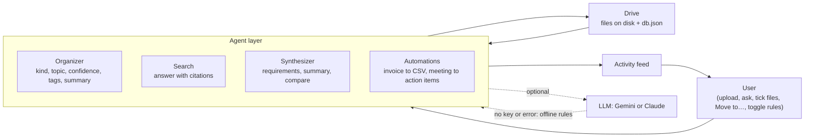

# Agentic Drive: Brainstorming

This is the thinking we did before writing code: what is wrong with cloud storage today, what we
wanted to change, which ideas we kept or dropped, and the four agent flows we designed the product
around. Section 8 adds what we learned when we rebuilt the Organizer in a second iteration.

Every example below uses the sample files that ship with the app (`src/samples/`). There are 32
documents from Brightleaf Labs, a made-up product studio in Lahore, covering Q3 2026. Each flow can be
reproduced with one click on "Load sample files".

## 1. The problem

Google Drive and Dropbox are filing cabinets. You put a file in, and it sits there until you
remember it exists, remember what you called it, and go and dig it out. The cabinet never reads
what is inside the folders. All of the work stays with the person:

- **Finding things.** You have to remember the file name or the exact words in it. Asking "what
  did we decide about the budget?" gets you a list of files to open, not an answer.
- **Keeping it tidy.** Someone has to invent folders, drag files into them, and stay disciplined.
  Most drives end up as one long "Uploads" list.
- **Joining the dots.** The real answer usually lives across three meeting notes, a spreadsheet and
  an invoice. Reading them all and writing the summary is manual work.
- **Admin.** Every invoice gets opened, the total copied into a spreadsheet, and the category
  guessed by hand. Every set of meeting minutes gets re-read to pull out who does what.

The brief puts it plainly: the passive "deposit and forget" model is out of date now that software
can read. We were asked for a drive that understands its own contents, organises itself and acts
like a research assistant, with the agent sitting between the person and their files.

## 2. The shift: from passive storage to an active workspace

Our one-sentence version: **the drive stops waiting to be asked and starts doing the work the
moment a file arrives.** Today the user talks to files. In Agentic Drive the user talks to agents,
and the agents read, file, answer, combine and act on the files.

| Job | Passive drive (today) | Active workspace (Agentic Drive) |
|---|---|---|
| Search | Type a keyword, get a list of file names, open each one | Ask a question in plain English, get a direct answer with numbered citations to the exact files |
| Organising | Make folders by hand, drag files in, forget to | The Organizer reads each upload and files it under a document kind (Invoices, Meeting Notes, Contracts...), adds a topic label, tags and a one-line summary, and says "Needs a look" when it isn't sure |
| Combining | Open 3 files side by side, copy and paste into a new doc | Tick the files, pick a format (requirements, summary or comparison), get a new document with a Sources list |
| Admin work | Copy each invoice total into a spreadsheet; re-read minutes for to-dos | Invoices log themselves into `expenses.csv`; meeting notes produce an action-items file |
| Trust | You did it yourself, so you know what happened | An activity feed says what every agent did and why, and each automation has an on/off switch |

The key word is *trigger*. A passive drive has one event, "user opens file". An active workspace
treats "file arrived" as the start of work.

## 3. Ideas we considered

We listed everything an agent could do with a drive, then sorted by: does it show the passive to
active shift, can it be demoed in seconds, and can it work without an AI key?

| # | Idea | Status | Reason |
|---|---|---|---|
| 1 | Auto-sorting on upload: a document kind, a topic label, tags and a summary | **Built** | The clearest "it organises itself" moment; the brief's capability 1. Version 1 used topic folders; version 2 sorts by kind (see section 8) |
| 2 | Ask questions across all files, answer with citations | **Built** | Replaces keyword search; citations make it trustworthy (capability 2) |
| 3 | Multi-file synthesis into a new document (3 formats) | **Built** | Turns reading three files into one click (capability 3) |
| 4 | Invoice upload → row in `expenses.csv` | **Built** | The brief's own example of a trigger-based workflow (capability 4) |
| 5 | Meeting notes → action-items file | **Built** | Second automation; the most common follow-up chore after a meeting |
| 6 | Activity feed of everything the agents did | **Built** | Autonomy without explanation feels like magic in a bad way |
| 7 | Works offline, upgrades with a Gemini or Claude key | **Built** | Judges and users can run it free; AI is an upgrade, not a requirement |
| 8 | "Other / Needs a look" for unsure files, plus a human "Move to…" that pins the file | **Built** (iteration 2) | A wrong but confident shelf hides a file; an honest "not sure" doesn't |
| 9 | Accuracy tests against labelled samples and blind holdout sets | **Built** (iteration 2) | Without a number we could not tell whether a rule change helped or just moved the mistakes around |
| 10 | Learn from the user's moves (re-train on "Move to…") | Later | Needs enough moves to learn from, and a way to undo a bad lesson |
| 11 | Duplicate and version detection ("final_v3_REAL.docx") | Later | Valuable, but needs content similarity across whole files; only invoice-number de-duplication made it in |
| 12 | Deadline reminders pulled from contracts | Later | Needs reliable date extraction plus a notification channel |
| 13 | "Explain this spreadsheet" in plain English | Later | Good fit, but CSV narration is its own project |
| 14 | Budget vs. actual check (invoices against `q3-budget.csv`) | Later | The best cross-reference idea we had; needs line-item matching we could not finish in time |
| 15 | Contradiction finder ("kickoff says $120k, wrap-up implies more") | Later | Very "aha", but easy to get wrong without a strong model |
| 16 | User-defined automation rules ("when X lands in Y, do Z") | Later | Two fixed rules with toggles were enough to prove the idea |
| 17 | Vector database for search | Dropped | BM25 keyword ranking plus a synonym list works offline on a small drive; no extra service to install |
| 18 | Voice notes transcription | Dropped | Scope: audio needs a speech model and a different upload path |
| 19 | OCR for scanned PDFs | Dropped | Scope: we read PDFs that already contain text |
| 20 | Auto-sharing files with the right teammates | Dropped | Privacy: an agent should never decide who sees your data |
| 21 | Auto-archive or delete "stale" files | Dropped | Breaks our rule that nothing destructive happens automatically |

## 4. Architecture sketch

The brief asks for a middle layer between the user and the files. That layer is four agents. Each
one first tries the optional LLM and falls back to its own offline rules if there is no key or the
call fails.

The upload pipeline runs in this order:

1. Extract the text (PDF, TXT, MD, CSV) and save the file.
2. The Organizer gives the file a kind, a topic and a confidence. If it is not sure, the kind is
   "Other".
3. Every enabled automation that matches the kind runs.
4. Activity entries are written.

When the user picks "Move to…", the file's kind or topic changes and the file is pinned. No
automation runs again for it.

## 5. The four agentic user flows

### Flow 1: Proactive organisation ("I never made a folder")
1. Start with an empty drive and click "Load sample files". This loads 32 Brightleaf documents:
   meeting notes, invoices and receipts, contracts, proposals, specs, reports, spreadsheets and
   HR files.
2. The Organizer reads each one and decides:
   - its **kind**, which is the shelf it sits on (Invoices & Receipts, Meeting Notes, Contracts &
     Agreements, Proposals & Briefs, Specs & Plans, Reports, Spreadsheets & Data, People & HR, or
     Other)
   - a **topic** label, such as Finance or Marketing
   - how sure it is
   - a handful of tags and a one-line summary
3. **Aha!** The categories fill up in the sidebar, with counts, and nobody created them.
   - The internal hackathon problem statement talks about invoices, yet it lands in Proposals &
     Briefs, because it is built like a brief, not like a bill.
   - The PrintHub invoice talks about a marketing campaign, yet its topic is Finance, because an
     invoice is a finance document first.
4. Upload something that fits no category well, such as a staff newsletter. It goes to Other and
   shows up under "Needs a look". One "Move to…" puts it right and pins it there.

### Flow 2: Semantic retrieval ("ask, don't dig")
1. Press Ctrl+K (⌘K on a Mac) to open the "Ask your drive…" bar. Type the brief's own question:
   *"What was the budget discussed in the Q3 marketing meetings?"*
2. Search splits every file into passages, widens the question with synonyms (budget also
   means spend, cost, allocation), and ranks the passages. It favours passages that cover the
   whole question, not just one word of it.
3. **Aha!** Instead of a list of files, you get the answer itself, pulled from all three meetings,
   and each line has a `[n]` citation:
   - $120,000 approved at the kickoff
   - $64,500 of it spent by the mid-point review
   - $118,200 spent by the wrap-up

   Click a citation and that meeting's notes open in the preview drawer. The same bar answers
   questions about the PDF invoices, the Acme contract or the budget spreadsheet, because every
   format is just text to the agent. Ask about a company that isn't in the drive and it says so
   instead of guessing.

### Flow 3: Cross-document synthesis ("three meetings, one document")
1. Tick the three Q3 marketing meeting notes (kickoff, mid-point review, wrap-up).
2. A floating bar appears: "3 selected → Combine into Requirements / Summary / Compare". Pick one.
3. The Synthesizer pulls out decisions, requirements, action items and money figures from all three.
4. **Aha!** A new document opens that tells the whole quarter's story, which no single file
   contains:
   - $120,000 approved
   - $64,500 spent by the mid-point, and $10,000 moved from events to TikTok ads
   - $118,200 spent in total, with $1,800 rolling over to Q4

   A Sources section lists the three files it came from, and the document is kept under
   "Generated".

### Flow 4: Automated workflows ("the paperwork does itself")
1. The samples include invoices in different layouts, all handled the same way:
   - CloudNest (text, "From:" line)
   - Skyway Travel (text, "Vendor:" line)
   - PrintHub and OfficeWorks (PDFs)
   - a cafe receipt with no invoice number
2. The invoice-to-CSV automation fires on each file filed as an invoice, with no click. It reads the
   vendor, invoice number, date and total, and picks a category.
3. **Aha!** `expenses.csv` appears under Spreadsheets & Data (topic Finance) and fills itself, one
   row per invoice. For example: $1,250.00 for CloudNest, $842.60 for Skyway Travel and $3,480.00
   for PrintHub. Upload the same invoice again and no duplicate row is added.
   - Meeting notes that only *discuss* overdue invoices are not logged, because they are filed as
     Meeting Notes, not as invoices.
4. Upload meeting minutes and an action-items file appears with the same topic, listing each owner
   and due date. For example: "Hina will set up the paid social ad accounts by July 10".
5. The activity feed records each step. Turn the rule off in the Automations panel and the next
   invoice is only filed, not logged.

## 6. Design principles

- **Works without AI.** Every feature runs on offline rules with no key. A Gemini or Claude key
  makes the answers better; it is never required. If the LLM fails, the agent uses the offline
  result and says so in the activity feed.
- **Every answer is cited.** Search never states a fact without a `[n]` that opens the source file.
  If nothing matches, it says "I couldn't find that in your files" instead of guessing.
- **Say "not sure" instead of guessing wrong.** A file the Organizer can't place confidently goes
  to Other and is flagged "Needs a look", rather than onto a shelf where nobody will look for it.
- **Agents explain what they did.** The activity feed is the agents' diary. It records what was
  filed where and how sure the Organizer was, which invoice was logged, which file was generated,
  and what you moved.
- **Nothing destructive happens automatically.** Agents add things (labels, tags, summaries, CSV
  rows, new documents). They never delete, overwrite or share a user's file. Deleting is always a
  human click.
- **The human keeps the switch.** Each automation can be turned off, synthesis only runs on files
  the user ticked, and a file the user moved stays where they put it.
- **Complexity hidden behind simplicity.** One page:
  - one "Ask your drive…" bar
  - a sidebar of categories
  - a bar that appears when you tick files
  - one button to load a full demo

## 7. Demo script for the 3-minute video

| Time | What we show | What we say |
|---|---|---|
| 0:00–0:20 | A messy normal drive, then our empty drive | "Cloud drives are filing cabinets. They store files but never read them." |
| 0:20–0:50 | Click "Load sample files". Categories with counts and topic chips appear. Open Proposals & Briefs to show the hackathon brief, which is not in Invoices | "We never made a folder. The Organizer read every file and filed it by what it is, not by which words it happens to use." |
| 0:50–1:05 | Upload a staff newsletter; it lands in "Needs a look"; use Move to… → Reports | "When it isn't sure, it says so. One click fixes it, and it stays fixed." |
| 1:05–1:30 | Open `expenses.csv` (one row per invoice, including the PDFs) and an action-items file; open Agent activity | "Invoices logged themselves. Meetings produced their own to-do list. The feed shows every step." |
| 1:30–2:00 | Ctrl+K: "What was the Q3 marketing budget?", then "What are the Acme payment terms?"; click `[1]` | "A direct answer, and a citation you can check in one click." |
| 2:00–2:30 | Tick the three Q3 meetings, then Combine into → Requirements; the new document opens | "Three meetings in, one document out: decisions, money and actions across the whole quarter, with sources." |
| 2:30–2:50 | Toggle the invoice rule off; point at the AI status pill (offline or Gemini/Claude) | "You stay in control, and it runs with or without an AI key." |
| 2:50–3:00 | Back to the full drive | "Agentic Drive: storage that does the work the moment a file arrives." |

## 8. Iteration 2: what we learned

**The bug that started it.** We uploaded the hackathon brief PDF to our own drive, and the
Organizer filed it as an **invoice** in **Finance**. The brief describes an invoice workflow, so it
mentions "invoice" and "total", and our first rules said "invoice + total = invoice". Invoices always
go to Finance, so that is where it landed. A document that *talks about* invoices got
filed as an invoice. Today the same PDF is filed under **Proposals & Briefs**.

**Structure beats keywords.** People don't recognise an invoice by the word "invoice". They
recognise its shape: an "Invoice Number:" line, a "Bill To:" line, a "Total Due:" line. So the new
classifier works like this:

- **Structure lines count most.** Each line that gives the document its shape is worth the most
  points.
- **Title words count some.** These are words in the file name or the first line.
- **Body words count a little, with a cap.** Twenty mentions of "invoice" can't outvote the shape of
  a real document.
- **An invoice has to look like one.** It needs at least two invoice-shaped lines and a money
  amount. That one rule fixed the brief, the meeting notes about overdue invoices, and the blog
  post about invoicing tools.

We also split one label into two: the **kind** (what the document *is*: invoice, contract,
meeting notes...) and the **topic** (what it is *about*: Finance, Marketing...). The kind decides
the shelf. The topic is a filterable chip. Version 1 shelved files in topic folders and showed the
type only as a badge, so one bad type guess also dragged the file into the wrong folder.

**Fail safe, and let a human finish the job.**

- **Unsure files go to "Other".** When the scores are close, the file goes to Other and shows up
  under "Needs a look". A file on the wrong shelf is worse than a file marked "not sure": nobody
  looks for a contract under Invoices.
- **"Move to…" lets the person fix it.** It fixes the file in one click and pins it, so no agent
  moves it back.
- **Moving never re-runs automations.** Moving a report into Invoices never quietly adds a row to
  `expenses.csv`.

**Measure on documents you haven't tuned on.** We wrote 32 samples with decoys built to fool us,
then a holdout set of 16 tricky texts. After tuning, the scores looked great: 32/32 and 16/16. But we had
tuned the rules on both sets, so those numbers flatter us.

So after tuning we wrote a fresh, blind set of 20 documents (holdout-2), and we never tune against
it. On holdout-2 the classifier gets **16 of 20 kinds right (80%)**, and all 4 misses land in
Other, not in a wrong category. The test now enforces both: at least 75%, and every miss must
fail safe.

Topics are weaker: 13 of 20 on the same set. Honest numbers told us where to put a human in the
loop, which a perfect-looking score never would have.

**Smaller lessons.**

- Sample data needs decoys, or every rule looks good.
- A rule written for one file ("if the name contains X") always passes its test and teaches nothing.
  We only add general patterns with their own unit tests.
- Old drives must keep working: on startup, files from version 1 are re-sorted offline with no AI
  calls.

## 9. What we'd build next

- **Learn from moves:** when people keep moving the same kind of file, suggest a rule or adjust the
  classifier, with an undo.
- **Better topics:** topic labels are the weakest part offline. An AI key helps, and the offline
  keyword lists need more work.
- **Budget vs. actual:** match every logged invoice against `q3-budget.csv` and warn when a cost
  centre is close to its limit.
- **Contradiction and change alerts:** flag when a new document disagrees with an older one
  ("wrap-up spend differs from the kickoff plan by X").
- **Deadline radar:** collect every "by <date>" from action items and contracts into one timeline.
- **Version detection:** spot near-duplicate files and offer, never force, a merge.
- **Your own rules:** a plain-English rule builder ("when a contract lands in Contracts &
  Agreements, extract the renewal date").
- **Embeddings and bigger drives:** move search to a vector index once drives grow past a few
  hundred files.
- **More inputs:** OCR for scanned PDFs, then voice notes and meeting recordings.
- **Teams:** shared workspaces with permissions that a human sets, not an agent.
