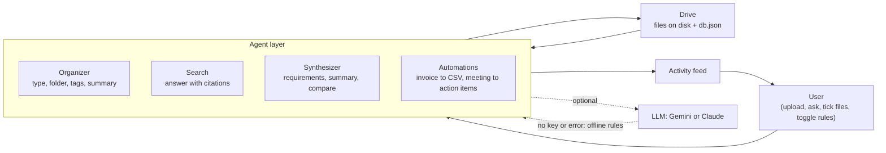

# Agentic Drive: Brainstorming

This is the thinking we did before writing code: what is wrong with cloud storage today, what we
wanted to change, which ideas we kept or dropped, and the four agent flows we designed the product
around. Every example below uses the sample files that ship with the app (`src/samples/`), so each
flow can be reproduced with one click on "Load sample files".

## 1. The problem

Google Drive and Dropbox are filing cabinets. You put a file in, and it sits there until you
remember it exists, remember what you called it, and go and dig it out. The cabinet never reads
what is inside the folders. All of the work stays with the person:

- **Finding things.** You have to remember the file name or the exact words in it. Asking "what
  did we decide about the budget?" gets you a list of files to open, not an answer.
- **Keeping it tidy.** Someone has to invent folders, drag files into them, and stay disciplined.
  Most drives end up as one long "Uploads" list.
- **Joining the dots.** The real answer usually lives across three meeting notes, a spreadsheet and
  an invoice. Reading them all and writing the summary is manual work.
- **Admin.** Every invoice gets opened, the total copied into a spreadsheet, and the category
  guessed by hand. Every set of meeting minutes gets re-read to pull out who does what.

The brief puts it plainly: the passive "deposit and forget" model is out of date now that software
can read. We were asked for a drive that understands its own contents, organises itself and acts
like a research assistant, with the agent sitting between the person and their files.

## 2. The shift: from passive storage to an active workspace

Our one-sentence version: **the drive stops waiting to be asked and starts doing the work the
moment a file arrives.** Today the user talks to files. In Agentic Drive the user talks to agents,
and the agents read, file, answer, combine and act on the files.

| Job | Passive drive (today) | Active workspace (Agentic Drive) |
|---|---|---|
| Search | Type a keyword, get a list of file names, open each one | Ask a question in plain English, get a direct answer with numbered citations to the exact files |
| Organising | Make folders by hand, drag files in, forget to | The Organizer reads each upload and gives it a folder, a type, tags and a one-line summary |
| Combining | Open 3 files side by side, copy and paste into a new doc | Tick the files, pick a format (requirements, summary or comparison), get a new document with a Sources list |
| Admin work | Copy each invoice total into a spreadsheet; re-read minutes for to-dos | Invoices log themselves into `expenses.csv`; meeting notes produce an action-items file |
| Trust | You did it yourself, so you know what happened | An activity feed says what every agent did and why, and each automation has an on/off switch |

The key word is *trigger*. A passive drive has one event, "user opens file". An active workspace
treats "file arrived" as the start of work.

## 3. Ideas we considered

We listed everything an agent could do with a drive, then sorted by: does it show the passive to
active shift, can it be demoed in seconds, and can it work without an AI key?

| # | Idea | Status | Reason |
|---|---|---|---|
| 1 | Auto-folders, tags and summaries on upload | **Built** | The clearest "it organises itself" moment; the brief's capability 1 |
| 2 | Ask questions across all files, answer with citations | **Built** | Replaces keyword search; citations make it trustworthy (capability 2) |
| 3 | Multi-file synthesis into a new document (3 formats) | **Built** | Turns reading three files into one click (capability 3) |
| 4 | Invoice upload → row in `expenses.csv` | **Built** | The brief's own example of a trigger-based workflow (capability 4) |
| 5 | Meeting notes → action-items file | **Built** | Second automation; the most common follow-up chore after a meeting |
| 6 | Activity feed of everything the agents did | **Built** | Autonomy without explanation feels like magic in a bad way |
| 7 | Works offline, upgrades with a Gemini or Claude key | **Built** | Judges and users can run it free; AI is an upgrade, not a requirement |
| 8 | Duplicate and version detection ("final_v3_REAL.docx") | Later | Valuable, but needs content similarity across whole files; only invoice-number de-duplication made it in |
| 9 | Deadline reminders pulled from contracts | Later | Needs reliable date extraction plus a notification channel |
| 10 | "Explain this spreadsheet" in plain English | Later | Good fit, but CSV narration is its own project |
| 11 | Budget vs. actual check (invoices against `q3-budget.csv`) | Later | The best cross-reference idea we had; needs line-item matching we could not finish in time |
| 12 | Contradiction finder ("kickoff says $120k, wrap-up implies more") | Later | Very "aha", but easy to get wrong without a strong model |
| 13 | User-defined automation rules ("when X lands in Y, do Z") | Later | Two fixed rules with toggles were enough to prove the idea |
| 14 | Vector database for search | Dropped | TF-IDF plus a synonym list works offline on a small drive; no extra service to install |
| 15 | Voice notes transcription | Dropped | Scope: audio needs a speech model and a different upload path |
| 16 | OCR for scanned PDFs | Dropped | Scope: we read PDFs that already contain text |
| 17 | Auto-sharing files with the right teammates | Dropped | Privacy: an agent should never decide who sees your data |
| 18 | Auto-archive or delete "stale" files | Dropped | Breaks our rule that nothing destructive happens automatically |

## 4. Architecture sketch

The brief asks for a middle layer between the user and the files. That layer is four agents. Each
one first tries the optional LLM and falls back to its own offline rules if there is no key or the
call fails.

Upload pipeline: extract text (PDF, TXT, MD, CSV) → save → Organizer files it → every enabled
automation that matches runs → activity entries are written.

## 5. The four agentic user flows

### Flow 1: Proactive organisation ("I never made a folder")
1. Start with an empty drive and click "Load sample files" (eight files: meeting notes, invoices,
   a budget sheet, an engineering spec).
2. The Organizer reads each one and decides its type (meeting, invoice, data, report), its topic
   folder, a handful of tags and a one-line summary.
3. **Aha!** Folders such as Marketing, Finance and Engineering appear on the left without anyone
   creating them. The PrintHub invoice talks about a marketing campaign, yet it lands in Finance,
   because the agent knows an invoice is a finance document first.

### Flow 2: Semantic retrieval ("ask, don't dig")
1. Open the Ask tab and type the brief's own question: *"What was the budget discussed in the Q3
   marketing meetings?"*
2. Search splits every file into passages, widens the question with synonyms (budget also
   means spend, cost, allocation), and ranks the passages.
3. **Aha!** Instead of a list of files, you get a sentence: the Q3 marketing budget was approved at
   $120,000, with a `[1]` citation. Click `[1]` and the kickoff minutes open in the viewer. The same
   box answers questions about the PDF invoice or the budget spreadsheet, because every format is
   just text to the agent.

### Flow 3: Cross-document synthesis ("three meetings, one document")
1. Tick the three Q3 marketing meeting notes (kickoff, mid-point review, wrap-up).
2. In the Synthesize tab choose a format (requirements, summary or compare) and click Generate.
3. The Synthesizer pulls out decisions, requirements, action items and money figures from all three.
4. **Aha!** A new document appears in the Generated folder that tells the whole quarter's story no
   single file contains: $120,000 approved, $64,500 spent by mid-August and $10,000 moved from
   events to TikTok, then $118,200 spent in total with $1,800 rolling over to Q4. A Sources section
   lists the three files it came from.

### Flow 4: Automated workflows ("the paperwork does itself")
1. Upload three invoices in three different layouts: CloudNest (text, "From:" line), Skyway Travel
   (text, "Vendor:" line) and PrintHub (a PDF).
2. The invoice-to-CSV automation fires on each one with no click. It reads the vendor, invoice
   number, date and total, and picks a category.
3. **Aha!** `expenses.csv` appears in Finance and fills itself: $1,250.00, $842.60 and $3,480.00.
   Upload the same invoice again and no duplicate row is added.
4. Upload meeting minutes and an action-items file appears next to them, listing each owner and
   due date (for example, "Hina will set up the paid social ad accounts by July 10").
5. The activity feed records each step. Turn the rule off in the Automations tab and the next
   invoice is only filed, not logged.

## 6. Design principles

- **Works without AI.** Every feature runs on offline rules with no key. A Gemini or Claude key
  makes the answers better; it is never required. If the LLM fails, the agent uses the offline
  result and says so in the activity feed.
- **Every answer is cited.** Search never states a fact without a `[n]` that opens the source file.
  If nothing matches, it says "I couldn't find that in your files" instead of guessing.
- **Agents explain what they did.** The activity feed is the agents' diary: what was filed where,
  which invoice was logged, which file was generated.
- **Nothing destructive happens automatically.** Agents add things (tags, summaries, CSV rows, new
  documents). They never delete, overwrite or share a user's file. Deleting is always a human click.
- **The human keeps the switch.** Each automation can be turned off, and synthesis only runs on
  files the user ticked.
- **Complexity hidden behind simplicity.** One page, three tabs (Ask, Synthesize, Automations), and
  one button to load a full demo.

## 7. Demo script for the 3-minute video

| Time | What we show | What we say |
|---|---|---|
| 0:00–0:20 | A messy normal drive, then our empty drive | "Cloud drives are filing cabinets. They store files but never read them." |
| 0:20–0:50 | Click "Load sample files"; folders, type badges, tags and summaries appear | "We never made a folder. The Organizer read every file and filed it." |
| 0:50–1:25 | Open Finance: `expenses.csv` with three rows, including the PDF invoice; open an action-items file; scroll the activity feed | "Invoices logged themselves. Meetings produced their own to-do list. The feed shows every step." |
| 1:25–1:55 | Ask: "What was the budget discussed in the Q3 marketing meetings?"; click `[1]` | "A direct answer, and a citation you can check in one click." |
| 1:55–2:30 | Tick the three Q3 meetings, choose a format, Generate; open the new document | "Three meetings in, one document out: decisions, money and actions across the whole quarter, with sources." |
| 2:30–2:50 | Toggle the invoice rule off; point at the AI status pill (offline or Gemini/Claude) | "You stay in control, and it runs with or without an AI key." |
| 2:50–3:00 | Back to the full drive | "Agentic Drive: storage that does the work the moment a file arrives." |

## 8. What we'd build next

- **Budget vs. actual:** match every logged invoice against `q3-budget.csv` and warn when a cost
  centre is close to its limit.
- **Contradiction and change alerts:** flag when a new document disagrees with an older one
  ("wrap-up spend differs from the kickoff plan by X").
- **Deadline radar:** collect every "by <date>" from action items and contracts into one timeline.
- **Version detection:** spot near-duplicate files and offer, never force, a merge.
- **Your own rules:** a plain-English rule builder ("when a contract lands in Legal, extract the
  renewal date").
- **Embeddings and bigger drives:** move search to a vector index once drives grow past a few
  hundred files.
- **More inputs:** OCR for scanned PDFs, then voice notes and meeting recordings.
- **Teams:** shared workspaces with permissions that a human sets, not an agent.
